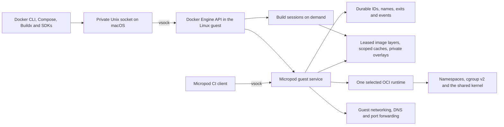

# Direct OCI runtimes on Gamma

Micropod can now run trusted offline CI from a published OCI bundle on a warm Linux guest with its own service, executor and one OCI executable. The submitter selects a bundle and cache scope on Micropod's private socket. The guest creates a writable overlay and cgroup for each job, executes it and removes both. Bundle lookup, dispatch and cache accounting all work on a guest with no Docker, Podman or containerd installation. [Run a published bundle](../../ci-worker.md#run-a-published-oci-bundle-directly)

## Timings and runtime behavior

Gamma is an 18-core M5 Max with 128 GiB. The direct runtimes and Ubuntu processes used the **same four-vCPU, 4 GiB Ubuntu guest, kernel boot and physical Go cache entries**. OrbStack 2.2.5 had the same VM budget on that Mac. Each container had one CPU and 1 GiB. Each source job started with a private writable checkout, ran vet and eight tests with `-count=1`, linked a program and checked its output. The table gives whole-batch medians. Runtime order rotated across five source rounds and six short-launch rounds. [Raw samples and per-job timings](raw-oci-runtimes.json.gz)

| Execution path | 16 source jobs | 32 source jobs | 16 short launches | 32 short launches | ARM64 runtime executable |
| --- | ---: | ---: | ---: | ---: | ---: |
| runc 1.5.2 | 5.04 s | 11.71 s | 108 ms | 211 ms | 12.63 MiB |
| crun 1.31 | 7.17 s | 9.22 s | 46 ms | 105 ms | 3.27 MiB |
| youki 0.7.0 | 7.90 s | 8.18 s | 97 ms | 150 ms | 6.50 MiB |
| Raw Ubuntu processes | 5.01 s | 10.45 s | — | — | — |
| OrbStack Docker | 9.93 s | 18.00 s | — | — | — |

The short payload reads the guest clock using `sh -ec 'date +%s%N'`. At 32 jobs the median time from the executor invoking the OCI runtime to the in-job timestamp was 125 ms for runc, 31 ms for crun and 67 ms for youki. This interval includes scheduling, runtime setup and starting the shell and clock utility. Median executor filesystem and spec setup was under 0.5 ms per job in every arm. For this prepared workload, changing the runtime had a much larger effect on launch than changing workspace setup could achieve.

To check whether the launch savings carried through full CI, we then ran six adjacent runc/crun pairs at each concurrency and alternated which ran first. At 16 jobs the medians were **4.07 s runc and 4.14 s crun**. At 32 they were **9.21 s runc and 9.18 s crun**. Each runtime won three of six pairs at each concurrency. These 576 additional source jobs used the same policy, kernel and cache files. The evidence favors crun for launch-heavy jobs and gives no whole-pipeline reason to switch the general default. Both the five-way comparison and the paired follow-up explicitly selected the ordinary scheduler for all OCI runtimes.

All 1,200 jobs in the five-way comparison produced the same executable, compiled zero packages, invoked no vet tools and performed three links per job. Every job still ran the vet command and the tests. The four paths sharing Ubuntu saw one device and inode for the module zip and one for its compiled dependency. The Go toolchain SHA-256 matched across the bundle and the raw guest. OrbStack used its own warm cache. The direct clients used a private Unix socket forwarded over SSH to the qualification guest and timed dispatch after opening the session. Raw Ubuntu timed work inside the guest, including the per-job checkout. OrbStack's clock included stock Docker client calls. Shared-host load varied substantially. For example, crun's five 32-job batches ranged from 5.39 to 39.02 s. A raw-process median is a comparison under these clocks and system load.

The nine archived Docker cases check arguments, output streams, exit status, workspace isolation, limits, policy, network, module bytes and a built program. Runc and crun matched all nine. Youki matched eight. Each runtime gave 16 simultaneous jobs distinct PID, mount, network, UTS, IPC and cgroup namespaces and one shared module archive. All three cancelled two running 90-second jobs. The guest ended with zero session, job and job-cgroup directories. [Recorded Docker behavior](oci-startup/docker-cases.tar.gz) · [Replay driver](../../../scripts/qualify_oci_replay.py)

With identical OCI input, runc and crun brought up the isolated loopback interface (`0x9`). Youki left it down (`0x8`). A separate Go program opened a TCP listener and connected to it over 127.0.0.1 on runc and crun. The connection failed with `network is unreachable` on youki. The native service therefore exposes youki only as an explicit bundle qualification option. The public Engine and existing image-handle defaults continue to use runc. An exclusive retirement lock succeeded before and after a session and was refused while the session held the bundle and scope. The tested crun and youki binaries came from their upstream ARM64 releases. [Youki v0.7.0](https://github.com/youki-dev/youki/releases/tag/v0.7.0) · [crun 1.31](https://github.com/containers/crun/releases/tag/1.31)

## Reproduction

Publish the source fixture and runtime policy once. For this trial the stock reference supplied a filesystem export, its OCI policy and the runc executable so the bytes matched. The native interface also accepts a bundle from a runner provisioner. Bootstrapping from an arbitrary image tag still requires an image importer. The smoke test verified the guest had no Docker, Podman or containerd binaries, running processes or engine sockets.

```sh
python3 scripts/bench_go_fanout.py --bundle "$BUNDLE_ID" --scope "$CACHE_SCOPE" \
  --runtime crun --clients 32 --same --output /tmp/crun-32.json
python3 scripts/qualify_oci_replay.py --bundle "$REPLAY_BUNDLE_ID" --scope "$CACHE_SCOPE" \
  --runtime crun --isolation-clients 16 \
  --corpus docs/benchmarks/2026-11-20/oci-startup/docker-cases.tar.gz --out /tmp/crun-replay.json.gz
python3 scripts/ci_benchmark_store.py raw-oci-runtimes docs/benchmarks/2026-11-20/raw-oci-runtimes.json.gz
```

The two fixture IDs identify different immutable checkouts. The source benchmark uses the fan-out fixture. The replay uses the archived example module and checkout. Both reuse the same scoped cache files. The `raw_oci_batches` SQLite view includes series, round, engine, concurrency, wall time, session-open time and the raw jobs.

## Keeping the Docker API

OrbStack on Gamma runs Docker Engine 29.8.2. Micropod's public worker endpoint runs 29.9.3. Both advertised Engine API 1.40 through 1.56. Replacing the OCI executable changes how Linux starts a process. Serving applications through the Docker socket also requires Docker's object model, stream protocols and error semantics. [OrbStack architecture](https://docs.orbstack.dev/docker/) · [Docker Engine API](https://docs.docker.com/reference/api/engine/version/v1.56/) · [OCI runtime lifecycle](https://github.com/opencontainers/runtime-spec/blob/main/runtime.md)

The proposed shared-VM architecture has one owner for each container, cache scope and image.



The direct bundle interface and private guest service run today. The general Docker adapter and common durable object lifecycle in the diagram are proposed. The public worker continues to serve Docker clients through its existing Engine. The separate Apple-container shim now advertises its actual 1.44 ceiling on the initial ping. On Gamma the stock CLI negotiated 1.44 after the fix and chose 1.55 before it.

1. **Make prepared inputs native.** The new bundle path reads an already-unpacked filesystem and a runner-published OCI policy. It opens existing cache directories by scope. Linux holds shared locks on both published directories throughout the session. The legacy image-ID path still calls Docker to resolve the image, capture the policy and verify its stopped volume owner. Image ingestion is the next dependency to remove. Resolve tags to immutable manifests, verify blobs and layer DiffIDs, apply layers and whiteouts once per ordered parent chain, and lease live snapshots while GC runs. Twenty jobs using one toolchain can then share one lower, one module store and one build store within their trust scope.
2. **Implement one public container lifecycle.** Start with create, inspect, attach, start, logs, wait, events and remove. Persist the container ID and reserved name before replying to create. Subscribe to exit before starting the task, spool output once, and record exit, waiters and events so clients can reconnect. Reconcile an interrupted start against the runtime state before retrying. A long-running service needs to survive an API frontend restart. Today's offline session intentionally cancels its jobs on disconnect. Expose public objects from one catalog so repeated creates, concurrent removes and Docker observers agree about the same job.
3. **Qualify the rest before cutover.** The pinned 1.56 specification contains 108 operations on 98 URL templates. Exercise version negotiation and version-specific behavior, registry auth and transfers, filtered events, attach/exec upgrades and TTY resizing, archives, volumes, DNS, published ports, plugins and Swarm in the corresponding cluster roles. For builds, keep the narrow native layer publisher for prepared CI products. Serve general Dockerfiles and Buildx sessions with a compatible builder on demand. Standalone BuildKit can fill that role independently of dockerd. Builds and runs must publish into the same logical image catalog. [Pinned API specification](https://github.com/moby/moby/blob/api/v1.56.1/api/docs/v1.56.yaml) · [BuildKit](https://github.com/moby/buildkit)
4. **Switch at the worker boundary.** First run a separate candidate endpoint. Replay requests against independently seeded fixtures, including Compose, Buildx and Testcontainers with Ryuk. Compare outcome, events, bytes and cleanup after disconnect, worker restart and concurrent prune. Migrate images by verified manifest and volumes by trusted scope on a quiescent worker. Keep the previous disk as a rollback point. A single writer owns the public socket and durable data at each stage.

Gamma's public Micropod and OrbStack sockets matched on all 26 probes with identical image input. The probes exercised 36 named operations and included real Compose, Buildx and Testcontainers clients. PostgreSQL started with its Ryuk reaper and completed the SQL round trip on both. The receipt includes the other 72 operations as unverified. [Public socket results and full operation inventory](docker-engine-contract.json.gz) · [Qualification driver](../../../scripts/qualify_engine_api.py)

An exploratory Ubuntu Podman 4.9.3 guest completed the Compose and Buildx fixtures, but advertised API 1.41, returned 500 for a duplicate name, emitted `remove` for Docker's `destroy` event and failed the PostgreSQL/Ryuk test on the default bridge name. The raw runtime comparison used a separate Ubuntu VM. [Podman's compatibility contract](https://docs.podman.io/en/latest/markdown/podman-system-service.1.html)

To replay the public contract, load the same trusted offline shell fixture and optional PostgreSQL test image on both endpoints. Point the driver at private Unix sockets.

```sh
python3 scripts/qualify_engine_api.py --reference "$REFERENCE_SOCKET" --candidate "$CANDIDATE_SOCKET" \
  --reference-image "$FIXTURE" --candidate-image "$FIXTURE" --postgres-runner "$POSTGRES_TEST_IMAGE" \
  --spec "$ENGINE_156_YAML" --output /tmp/engine-contract.json.gz
```
