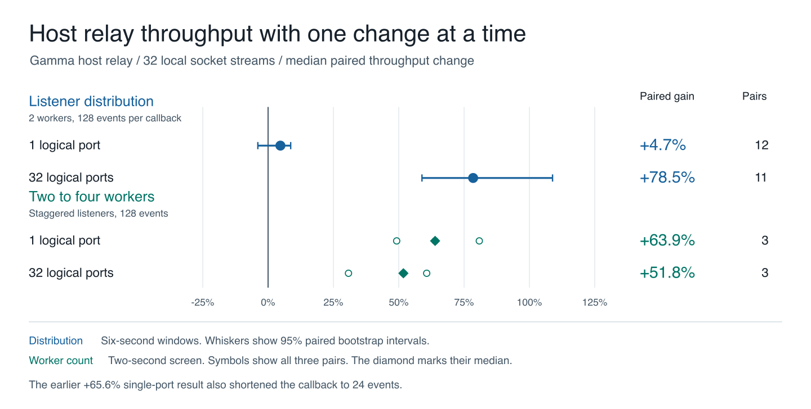
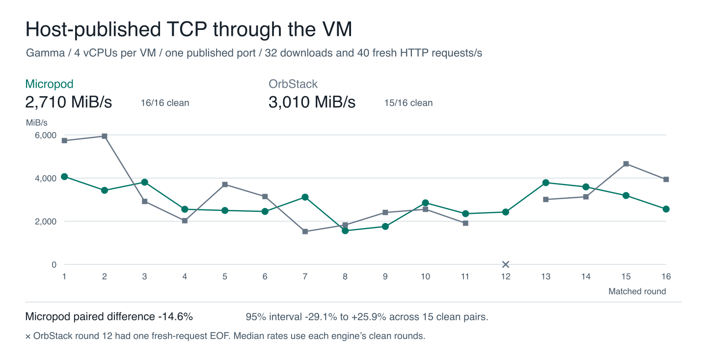

# Gamma host-published TCP, 22 November 2026

Staggering the first connection on each of 32 logical ports raised median paired relay throughput **78.5%** with two workers. Increasing the worker count from two to four at the same 128-event callback budget raised throughput **51.8%** on 32 ports in a short screen. Fresh-request p99 in that screen rose from **19.5 to 30.5 ms**. The latest four-vCPU end-to-end holdout put Micropod **14.6% behind OrbStack** on paired throughput. A six-vCPU result on this workload is still outstanding.

## Host relay



The fixture ran the Darwin kqueue relay between connected local stream sockets on Gamma-128GB. CPU measurements cover the entire process including clients and payload verification. Port count, workers and callbacks refer to this host process. It runs without a VM or container image.

| One change, control → candidate | Ports | Clean rounds | Bulk MiB/s | Paired change | Fresh p95, ms | Fresh p99, ms | CPU-s/GiB | Failed fresh requests |
| --- | ---: | --- | --- | --- | --- | --- | --- | --- |
| Listener distribution, 2 workers | 32 | 11/12 → 12/12 | 5,046 → 9,271 | +78.5% [58.9%, 108.9%] | 19.3 → 18.5 | 22.2 → 24.3 | 0.462 → 0.509 | Unknown in control round 5 → 0 |
| Listener distribution, same one-port routing | 1 | 12/12 → 12/12 | 8,656 → 9,412 | +4.7% [−3.9%, 8.7%] | 18.3 → 17.8 | 21.0 → 20.3 | 0.524 → 0.510 | 0 → 0 |
| 2 → 4 workers, staggered listeners | 32 | 3/3 → 3/3 | 10,627 → 16,129 | +51.8%, pairs +30.8% to +60.7% | 16.9 → 22.2 | 19.5 → 30.5 | Unavailable | 0 → 0 |
| 2 → 4 workers, staggered listeners | 1 | 3/3 → 3/3 | 10,641 → 16,205 | +63.9%, pairs +49.2% to +80.8% | 17.2 → 17.4 | 19.5 → 18.4 | Unavailable | 0 → 0 |

All four contrasts fixed the callback budget at 128 events. With one download per port, staggering changed the assignment across two workers from 32/0 to 16/16. On one port the assignment was 16/16 with either policy. The listener confirmation used 32 bulk streams plus 240 independent pthread probes at 25 ms intervals over six seconds. The old layout timed out while waiting for the final probes in one round. Its surviving records verify 2,640 fresh replies across the other 11 rounds. The candidate verified all 2,880. Host runnable counters were absent from both relay archives.

The worker-only screen used the same arrival rate and bulk stream count, with **80 probes over two seconds** and a libdispatch client. All six arm-runs per topology finished cleanly. The earlier six-second **+65.6%** single-port gain changed both workers (2 → 4) and callback length (128 → 24). In a separate callback-only screen at four workers, shortening the callback changed paired throughput by +0.8% [−13.8%, +1.3%] on one port. Neither screen determines the isolated six-second worker effect. [Original relay receipt](gamma-relay-workers.json.gz)

## End-to-end VM



The 21 November holdout measured one Mac TCP port through the VM to the same ARM64 server on each engine. Both VMs had four vCPUs and 4 GiB RAM. Both containers ran with a four-CPU quota (400000/100000), CPUs 0–3, 1 GiB RAM and a 512-PID limit. The image configuration digest was `sha256:80996a25c9c753fcaf3f421a3f61557497b8ab539bdd68076074d181cfa71889`. Each round offered 32 continuing 8 MiB downloads and 240 new HTTP identity requests at 25 ms intervals over six seconds. Fresh latency starts at the scheduled arrival.

| Measured quantity | Micropod | OrbStack |
| --- | ---: | ---: |
| Bulk throughput, MiB/s | 2,710 | 3,010 |
| Clean rounds | 16/16 | 15/16 |
| Fresh failures / offered, all rounds | 0 / 3,840 | 1 / 3,840 |
| Reopened bulk connections, all rounds | 0 | 0 |
| Fresh p95 / p99, ms | 35.2 / 58.1 | 220.3 / 1,027.4 |
| VMM CPU-s/GiB | 0.605 | 1.074 |
| VMM runnable thread-s/s, including execution | 3.654 | 8.845 |
| VMM runnable wait, thread-s/s | 2.094 | 6.285 |
| Raw VMM runnable seconds per sampling bracket | 22.62 | 66.74 |
| Host sampling bracket, seconds | 6.19 | 7.31 |

Micropod won 7 of the 15 common clean pairs. Its median within-pair difference was **−14.6%** with a **95% interval of −29.1% to +25.9%**. OrbStack round 12 recorded a fresh `GET /id` EOF. All 32 bulk streams had completed their identity warmup and delivered bytes. The previous −9.5% came from an earlier Gamma holdout. Neither figure measures the updated four-worker relay through a VM. [Original VM receipt and workload source](../2026-11-21/gamma-vcpu-priority.json.gz)

Medians use each engine's clean rounds. Drops and reopens count all attempts. Effects use the median of candidate/control throughput ratios from the same numbered clean pairs. Bracketed intervals resample whole pairs 10,000 times. The historical relay confirmation cycled the six arm orders twice. The VM holdout alternated AB/BA. The schedules printed below randomize within balanced pairs for new runs.

VMM CPU and runnable time come from before/after Darwin process counters, converted from Mach ticks. The sampler brackets the complete client invocation, including per-stream warmup and drain. CPU-s/GiB divides those CPU seconds by bytes delivered in the six-second scoring window. Runnable wait subtracts CPU time before dividing by the actual sampling duration. On Micropod the separately recorded supervisor added 0.348 CPU-s/GiB and 1.020 runnable thread-s/s (0.124 waiting). Summing both processes within each clean round gave **0.956 CPU-s/GiB** at the median. The OrbStack column covers its helper process. Separate scheduler traces estimated **vCPU-thread** wait of 1.32 thread-s/s for Micropod (4 clean traces) and 1.64 for OrbStack (3). [Per-round counters, sampling durations and paired results](gamma-tcp-contrasts.json)

## Smallest owner-run tests

At 11:05 AEDT on 22 November, connecting to Gamma's OrbStack Docker socket and binding a temporary IPv4 loopback listener each returned `EPERM`. Neither original holdout container is still running. The TCP handoff was left in the warm-CI owner's benchmark directory. There was no acknowledged reservation for this round of work. No new timed load ran on Gamma.

Each command below describes a separate pilot. Select one in a window the warm-CI owner has released. Each uses three equal warmup pairs and the minimum two scored pairs needed to exercise both orders. One arm runs at a time. That is **24 scored seconds, 60 offered-load seconds total**, plus setup and drain **per pilot**. Print any order by omitting `--run` and `--out`. With seed 34199 the warmups are AB, BA, BA and the scored pairs BA, AB. Two pairs are enough to check direction, failures and cost. A bandwidth claim needs an independent holdout.

| In order | A → B | Fixed within the pair |
| --- | --- | --- |
| 1. Listener distribution | Per-port cursor starting at zero → staggered cursor | Same C revision, two workers, 128-event callback, 32 logical ports |
| 2. Relay workers | Two → four | Same executable, staggered cursor, 128-event callback, same logical port count |
| 3. VM vCPUs | Four → six on Micropod | Same service image and client, two relay workers, 128-event callback, one Mac port, four-CPU container budget |
| Independent peer check | Four-vCPU Micropod → four-vCPU OrbStack | Same qualified workload, image, VM size, container cap and host |

For the first two tests, use one topology per command. The host fixture verifies every stream, fresh marker, half-close and total byte count. The new pilot also saves whole-process runnable and CPU counters during the scoring window, per-request timings and the number submitted and answered even on a timeout. A one-port control uses the same command with `--ports 1`. The fixture measures the local relay at the same offered rate as the VM benchmark. [Host pilot](../../../scripts/relaybench/gamma_relay_pilot.py)

```sh
python3 scripts/relaybench/gamma_relay_pilot.py distribution --ports 32 --seed 34199 --run --out "$NEW_PLACEMENT_RESULTS"
python3 scripts/relaybench/gamma_relay_pilot.py workers --ports 32 --seed 34200 --run --out "$NEW_WORKER_RESULTS"
```

For the VM pilot, `SCOPE4` and `SCOPE6` identify the owner's **already running, dedicated** Micropod fixture records in the original `WORK/data/<fixture>` format. Each provides `base`, `id`, `name`, `addr`, `vmm` and `relay`. The base worker has a current session and its launchd job record. Both must use the same Micropod build, 7.3.5 kernel, direct macvlan/Reno route, Interactive relay with a 512 KiB guest receive buffer, 4 GiB VM memory, original image and container limits above. The owner designates idle fixtures and confirms the current Gamma window. The pilot checks their live identities, ports, quota, memory and PID limits before load and again afterward. It records the effective cpuset on each VM. The client and counter sampler are checked against the hashes of the original Gamma executables.

```sh
python3 scripts/relaybench/gamma_pilot.py --mode size --seed 34199 --a "$SCOPE4" --b "$SCOPE6" --run --out "$NEW_VCPU_RESULTS"
```

If the owner reports restored peer access, the smallest check verifies both four-vCPU fixtures and their host counters with zero timed load. It checks the OrbStack side first. A separate reserved timing can use `--run` with a fresh result directory.

```sh
python3 scripts/relaybench/gamma_pilot.py --mode peer --a "$SCOPE4" --b "$ORB4" --check --out "$NEW_PREFLIGHT_RESULTS"
```

Each clean arm must have 32 positive per-stream totals summing to the scored bytes, 240 scheduled arrivals, zero client errors and zero reopens. Retain every dirty attempt, including partial output, with its pair and position. An interrupted client can leave the fresh-failure count unknown. Pair only the rounds both arms completed cleanly. The prior `confirm-micropod` and `confirm-orb` scopes carry retirement records. The pilot rejects them before connecting. [VM pilot](../../../scripts/relaybench/gamma_pilot.py)

The JSON and figures can be regenerated offline from the two checksum-pinned archives. The plot command uses ReportLab and `rsvg-convert`.

```sh
python3 scripts/relaybench/gamma_contrasts.py docs/benchmarks/2026-11-22/gamma-tcp-contrasts.json
python3 scripts/relaybench/plot_contrasts.py docs/benchmarks/2026-11-22/gamma-tcp-contrasts.json
```
