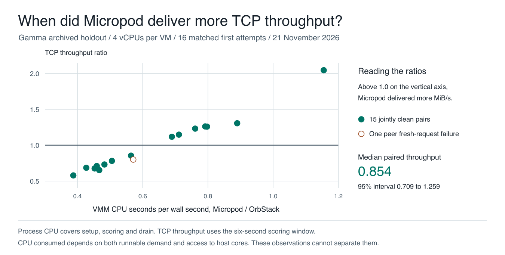

# Micropod published TCP · Batch 3 and the OrbStack gap

24 November 2026 · Ten distinct comparisons, bringing the recorded total to 30. Eight used raw historical VM observations and two exercised the local Darwin relay with fixed work. The additional accounting sensitivity, clean replays, correctness assertions and capacity check contribute zero to the count. [First batch](backlog-batch-01.md) · [Second batch](backlog-batch-02.md) · [GitHub register milestone](https://github.com/castlemilk/micropod/issues/227#issuecomment-7118391347)

## Where the gap shows up

On the last four-vCPU holdout, Micropod delivered 2,709.8 MiB/s and OrbStack 3,010.4 MiB/s using each engine’s clean-round median. Across the 15 rounds clean on both engines, Micropod won seven. Its median within-pair throughput ratio was 0.854 (95% paired bootstrap interval 0.709–1.259). Micropod fulfilled 3,840/3,840 fresh requests, OrbStack 3,839/3,840. Neither reopened a bulk stream. Clean-round median fresh p95/p99 was 35.2/58.1 ms for Micropod and 220.3/1,027.4 ms for OrbStack. The historical holdout alternated AB/BA. It predates the revised relay. [Original VM measurements](../2026-11-22/gamma-tcp-contrasts.md#end-to-end-vm)

Two observations narrow the diagnosis.

1. **The bulk deficit can precede connection churn.** In two jointly clean older traces the published path delivered 79% and 55% of the peer’s rate on 32 warm sockets in the 350 ms before the first fresh request. That fell to 34% and 27% immediately afterward. The third release comparison had a peer reopen. One onset sign reversed at 100 ms, and the older three-pair cohort had mixed signs. This locates a symptom in established bulk delivery and leaves room for fresh requests to amplify it. The closed-loop traces predate the six-second fixed-offer holdout. [Window lengths, all traces and first attempts](fresh-boundary-bulk.json)
2. **VM process CPU use tracks the swings.** The relative CPU time consumed per second by the two VM processes rose and fell with relative throughput in the historical holdout. Holding that one ratio at its observed median in an accounting calculation reduced the standard deviation of log throughput ratios from 0.358 to 0.056. The fixed-ratio median moved from 0.780 to 1.088 when refitting after dropping one two-pair block at a time. The accounting identity uses scored bytes in its efficiency term. It establishes neither scheduler causality nor an achievable improvement. The counters span setup and drain, and each engine puts different work in its VM process. [Raw-derived analysis](peer-vmm-service.json) · [Ticket receipt](https://github.com/castlemilk/micropod/issues/228#issuecomment-7118318170)

To tell whether Micropod is waiting for a host core or waiting for data, compare each vCPU’s **running, runnable-but-waiting and blocked time** against delivered bytes during the exact scoring interval. On the Micropod side, the opt-in relay diagnostic now distinguishes writes blocked toward the host client from writes blocked toward the guest. Use it in a separate profiling window so instrumentation does not change the throughput control. Earlier high-frequency vCPU traces were collected separately from the scored holdout. They cannot identify the stalled component in an individual scored pair. [Historical scheduling trace](../2026-11-21/gamma-vcpu-priority.md) · [Directional fixture](directional-backpressure.json)

## Ten comparisons

| # | Existing direction | Evidence tier | Verdict | Local evidence |
| --- | --- | --- | --- | --- |
| 1 | [231.01 Kernel work when transmit segmentation offload is disabled](https://github.com/castlemilk/micropod/issues/231#issuecomment-7118327590) | Archived VM | Keep transmit segmentation offload. Disabling it cut 6,026 to 516 MiB/s and raised notifications from 72 to 4,065 per interface GiB. | [tso-driver-work.json](tso-driver-work.json) |
| 2 | [231.08 A 512 KiB requested virtio TX byte queue ceiling](https://github.com/castlemilk/micropod/issues/231#issuecomment-7118330490) | Archived VM | The 512 KiB queue request produced 4/4 clean attempts and zero NIC drops versus 0/4 clean and 267 drops. Verify the effective setting before crediting it. | [bql-requested-ceiling.json](bql-requested-ceiling.json) |
| 3 | [231.07 Service pacing with NIC pacing already disabled](https://github.com/castlemilk/micropod/issues/231#issuecomment-7118332846) | Archived VM | Turning off service pacing gained 6.23% throughput with NIC pacing already off. Queue drops rose from 997 to 8,716. Keep pacing. | [fq-service-pacing-nic-off.json](fq-service-pacing-nic-off.json) |
| 4 | [231.08 Service queue quantum at fixed 64 KiB NIC quantum](https://github.com/castlemilk/micropod/issues/231#issuecomment-7118334547) | Archived VM | The 64 KiB service queue quantum won 1/5. Median paired throughput fell 15.53% and drops rose. Keep the control quantum. | [fq-service-quantum-nic64.json](fq-service-quantum-nic64.json) |
| 5 | [230.11 More frequent Darwin ACKs at the same requested receive window](https://github.com/castlemilk/micropod/issues/230#issuecomment-7118322096) | Archived VM | Extra ACKs at the same requested receive window cut qualifying attempts from 4/5 to 3/5. One candidate delivered zero bulk bytes. Keep the control. | [darwin-ack-policy.json](darwin-ack-policy.json) |
| 6 | [230.07 Which side of the relay encountered backpressure?](https://github.com/castlemilk/micropod/issues/230#issuecomment-7118320251) | Host-only fixture | Directional counters identified whether the host- or guest-facing socket stalled. Aggregate counters gave the same answer for both. Use this for diagnosis. | [directional-backpressure.json](directional-backpressure.json) |
| 7 | [230.03 Queued fresh handoff versus actual fresh reply](https://github.com/castlemilk/micropod/issues/230#issuecomment-7118338296) | Host-only fixture | A 24-event callback started handoffs up to 2 MiB earlier. The first reply still waited behind exactly as much bulk work in all five positions. Keep 128 for the worker comparison. | [callback-handoff-work.json](callback-handoff-work.json) |
| 8 | [230.15 Separating client launch delay from read-cap tail latency](https://github.com/castlemilk/micropod/issues/230#issuecomment-7118336518) | Archived VM | Increasing reads from 256 to 512 KiB improved post-launch fresh p95 in two pairs, worsened it in two and was unresolved in three. Keep read size separate. | [read-cap-dispatch.json](read-cap-dispatch.json) |
| 9 | [237.06 Can service quota throttling account for the fresh-request delay?](https://github.com/castlemilk/micropod/issues/237#issuecomment-7118324091) | Archived VM | Moving fresh requests to a sibling cut throttled fresh-service rounds from 5/8 to 0/8. It improved p95 in 4/8 and paired throughput changed −0.12%. Two pairs improved with zero fresh-service throttles in both arms. | [sibling-quota-pressure.json](sibling-quota-pressure.json) |
| 10 | [230.04 Bulk delivery immediately before and after fresh requests](https://github.com/castlemilk/micropod/issues/230#issuecomment-7118325735) | Archived VM | On both clean 350 ms release traces, the peer led before fresh requests began. Adding fresh requests widened the deficit. Earlier traces and shorter intervals gave mixed results. | [fresh-boundary-bulk.json](fresh-boundary-bulk.json) |

All eight archived comparisons retained the first attempts available for their selected arms. Several controls were intentionally conditional, including pacing on an already-unpaced NIC and the quantum on a fixed 64 KiB NIC. Hardware queue drops, application errors and stream reopens describe different events. The 512 KiB BQL result lacks a clean control rate and a numeric ceiling readback. The two host fixtures count work and verify delivery without timing the host. None of these comparisons qualifies a throughput gain on the revised VM or a peer win.

## Resume point

At 11:33 AEDT, read-only Cuttlefish showed 0/6 leases on the Gamma Mac and 1/1 on its isolated Linux runner. The latest available owner note contained no qualified stock receipt or current handoff for an already-serving scope. There was no live preflight, VM timing or renewed OrbStack access probe during this batch. The first live result remains the revised four-vCPU, two-worker stock baseline, reusing an owner-qualified receipt if one arrives. Then change only two to four relay workers with four vCPUs and a fixed 128-event callback. The host-only worker screen’s +63.9% was over three pairs. The revised VM effect is unknown. [Worker screen and peer criteria](../2026-11-23/gamma-throughput-gap.md#first-released-window)

The owner release must name the mode, window and serving scopes. Confirm effective disk clearance throughout, eligible idle lanes and fixture preflight. Listener distribution, same-kernel bridge/direct, read size and four versus six vCPUs remain separate. Peer qualification still requires confirmed peer access, equal budgets, randomized counterbalanced first attempts, clean delivery, fresh latency, per-process CPU/GiB and runnable time.

## Reproduce locally

Run each entry as `python3 -B scripts/relaybench/<command>` in the performance worktree. The JSON records contain the original acquisition identifiers and fixture or archive hashes. Each child receipt records the full local revision. Published issue comments cite report filenames. Private inputs and local commits remain in the worktree.

| Report | Local revision | Command |
| --- | --- | --- |
| tso-driver-work.json | `4ae11c69` | `tx_offload_bql_replay.py nic` |
| bql-requested-ceiling.json | `4ae11c69` | `tx_offload_bql_replay.py bql` |
| fq-service-pacing-nic-off.json | `4ae11c69` | `fq_service_policy_replay.py pacing` |
| fq-service-quantum-nic64.json | `4ae11c69` | `fq_service_policy_replay.py quantum` |
| darwin-ack-policy.json | `d84993df` | `darwin_ack_policy.py` |
| directional-backpressure.json | `d84993df` | `directional_backpressure.py` |
| callback-handoff-work.json | `147bf0a2` | `callback_handoff_work.py` |
| read-cap-dispatch.json | `147bf0a2` | `read_cap_dispatch.py` |
| sibling-quota-pressure.json | `d84993df` | `sibling_quota_replay.py` |
| fresh-boundary-bulk.json | `4ae11c69` | `fresh_boundary_bulk.py` |
| peer-vmm-service.json (supplemental) | `d84993df` | `peer_vmm_service.py` |

Regenerate the figure with `python3 -B scripts/relaybench/plot_peer_cpu_service.py docs/benchmarks/2026-11-24/peer-vmm-service.json` using ReportLab and librsvg.
