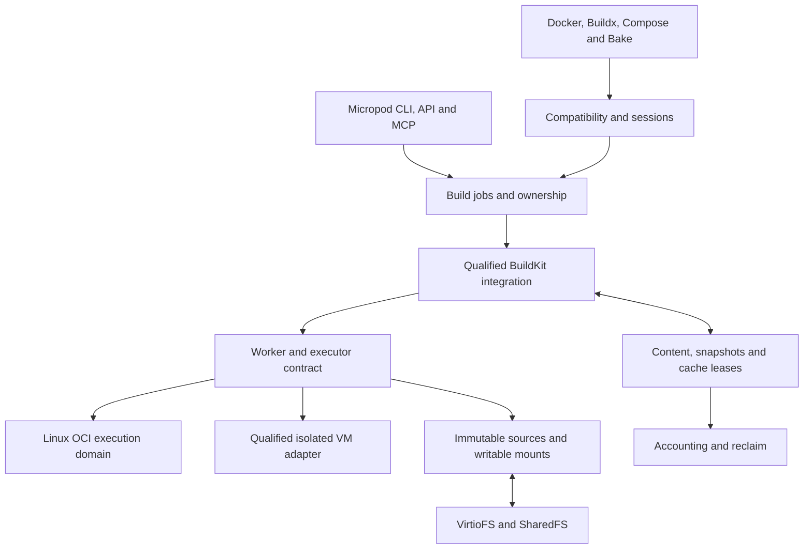

# Core container platform: builds, runtime equivalence and filesystem performance

**Direction updated 19 November 2026 following product-owner feedback.** The initial reconciliation under-scoped the core platform and gave Kubernetes too much prominence. This document supersedes that implementation ordering. The primary product outcome is a complete container build and execution platform with reliable, fast caching and host–guest filesystems. Kubernetes consumes that platform after the core contracts work.

Tracker: [#180](https://github.com/castlemilk/micropod/issues/180). Documentation review: [#194](https://github.com/castlemilk/micropod/pull/194). Source remains pinned to [`54980012`](https://github.com/castlemilk/micropod/commit/54980012eb47b458a7f7e1def616d3fa95c970a2).

[Build platform](build-platform.md) · [Runtime equivalence](runtime-compatibility.md) · [Cache and filesystem design](cache-and-filesystem.md) · [Full original crosswalk](roadmap.md) · [Benchmark method](benchmark-plan.md)

## What replacement means

Micropod should own its build jobs, builder lifecycle, execution, caches, image results, filesystems and public API. Existing Docker/Buildx/Compose workflows should work without a legacy-builder environment override. Native Micropod CLI/API/MCP workflows should expose the same operations without depending on a user's manually configured Docker Desktop environment.

Buildx is the build client; BuildKit is the service performing builds. runc is a Linux OCI execution implementation. The Docker Engine API, BuildKit control/session APIs, OCI runtime bundle/behavior and containerd shim API are distinct contracts. A socket, an OCI image import or a successful Alpine launch does not establish parity across them. [Docker architecture](https://docs.docker.com/build/concepts/overview/), [OCI runtime specification](https://github.com/opencontainers/runtime-spec), [runc](https://github.com/opencontainers/runc).

The implementation strategy is to own the product integration while reusing qualified upstream primitives. Inspect the supported installed Apple builder before adding another builder VM: Apple's current `container` documentation already describes a BuildKit-backed builder. An independent replacement for the BuildKit solver/frontends/cache formats would be a separate, much larger undertaking with its own compatibility and maintenance obligations. A custom Micropod worker or executor remains a meaningful optimization path once the reference path and semantics are measurable. [Apple command reference](https://github.com/apple/container/blob/main/docs/command-reference.md), [detailed build design](build-platform.md).

## Three first-class workstreams

| Workstream | Required outcome | Existing owners |
|---|---|---|
| Build platform | Native versioned build service, Docker/Buildx/Compose/Bake compatibility, sessions, source transfer, image outputs, persistent caches and recovery | #149 parent, #150 image interoperability, #151 credentials |
| Runtime equivalence | A declared Linux OCI/runc reference profile with complete behavior for required lifecycle, process, resource, namespace, mount and security controls, plus Docker-facing semantics | #136 contracts, #141 transport, #145 isolated profile, #146 guest stack, #147 Docker compatibility, #66 exits, #74 networking |
| Cache and filesystem | Correct immutable source/content identities, live-reference protection, useful cross-build reuse, actual space accounting, APFS clone performance, VirtioFS coherence and durability | #93 events, #160–167 sharing, #168–172 storage, #182 measurements |

These workstreams share interfaces and validation but retain separate implementation owners. Kernel and guest components serve the selected execution domains; integrating containerd/runc does not require putting every workload into a single global shared-kernel VM. An execution domain can be a trusted local builder or a separately isolated CI VM. Linux host namespace behavior is scoped to that Linux domain, never silently reinterpreted as access to the macOS host.

## Architecture and integration boundaries

The following diagram describes the intended contracts, not code already implemented. Reuse of the existing Apple builder or a Micropod-managed upstream BuildKit instance is decided through the installed-builder inventory. Native clients and compatibility clients converge on one ownership and capability model.

The native worker path must satisfy the same required executor contract as the reference path, including cancellation, ownership and storage reference lifetimes. A lower-level language change cannot substitute for those contracts.

## Concrete evidence behind the expanded scope

The three linked audits contain pinned file/line references. Findings are from source inspection; their proposed regression fixtures and native qualification have not run in this investigation.

| Finding | Why it matters |
|---|---|
| Build context identity excludes executable mode/ownership and skips PAX semantics while sorting entries | Equal keys can describe different effective sources; metadata-only changes and duplicate-path ordering need differential fixtures and a versioned key |
| Current build handling has whole-body tar ingestion, unconditional ignore-file removal and incomplete option/session representation | The build platform needs source-specific filtering, bounded transfer, full sessions and immutable source snapshots |
| Build prune returns an empty successful response without invoking reclamation | Cache lifecycle and actual backend ownership are product behavior, not optional telemetry |
| Native build work is an internal CLI delegation, while the inspected public image proto has no complete BuildService | Build jobs, progress, cancellation, reconnect and result identity need an explicit versioned public contract |
| Docker HostConfig represents a subset of semantic fields | Required security/resource/namespace fields need correct translation or explicit pre-execution failure; dropping them cannot count as compatibility |
| Docker exec string User decoding, attach stdin and requested kill-signal handling have concrete gaps | Interactive shells, least-privilege execution and process control need direct behavior tests, not route-presence checks |
| Missing wait information can still become exit code zero in the event path | Completion, nonzero status and unknown outcomes must remain authoritative; #66 keeps the existing defect ownership |
| A successful per-file clone can fall through into Data read/write copying | The intended APFS fast path needs a concrete fix and physical accounting; a clone attempt does not prove copied bytes were avoided |
| Chunk ingestion can return partial block identities after a write failure; block reads lack a content-name verification check | Manifest publication and content integrity need transactional guarantees before broad CAS reuse or remote cache import |
| SharedFS metadata/event semantics and context accounting are incomplete | Cache performance needs validated invalidation, file identity and honest logical/allocated/reclaimable byte scopes |

See [build findings](build-platform.md), [runtime findings](runtime-compatibility.md), and [cache findings](cache-and-filesystem.md). A documented intentional behavior such as the existing empty-block-list tombstone contract is treated as a versioned interface decision, not automatically labelled an accidental regression.

## Full runtime equivalence needs a testable target

Select a pinned runc version, OCI specification, Linux kernel/configuration, architecture, cgroup mode and privilege profile. Maintain a machine-readable matrix of required fields/operations, their expected behavior, Micropod path and qualification evidence. The baseline general-purpose Linux container profile must pass every feature it promises. Marking a required feature unsupported leaves the replacement incomplete; it does not turn that feature into a pass.

Keep specialized profiles explicit. A rootless profile, a restricted CI profile and a rootful development profile legitimately grant different privileges, but their constraints must be visible before creation. Unknown Docker extension keys follow the selected Docker API's compatibility rules; known security/resource fields of that API must not be silently discarded. This distinction avoids replacing one incompatibility with an overly strict decoder.

The coverage includes create/start/exec/wait/signal/delete and event ordering; PID1/reaping; stdin/TTY/resize/detach; UID/GID/groups/cwd/env; CPU/memory/pids/IO controls; user/PID/IPC/network/cgroup namespaces; mounts, propagation, tmpfs and devices; capabilities, seccomp, no-new-privileges and selected LSM support; lifecycle hooks and bundles; rootless delegation; and containerd task/shim recovery. runc extensions such as checkpoint/restore are tracked separately from normative OCI requirements but remain explicit product scope decisions. [Runtime matrix and ticket decomposition](runtime-compatibility.md).

## Cache layers must have separate semantics

| Layer | Identity and consistency | Reuse and lifetime |
|---|---|---|
| Source/context snapshot | Effective filtered source tree, normalized semantic metadata and links | Immutable per-build input; partial transfer cannot publish a valid reference |
| BuildKit solver/result cache | Frontend/LLB operation, inputs, platform and relevant options | Reuse unaffected graph vertices; local/remote import/export follows supported BuildKit formats |
| Mutable cache mounts | Stable scoped cache ID, sharing mode and mutable content | Package/compiler cache contents are not automatically included in layer-cache export; define separate restore policy |
| OCI blobs and unpacked snapshots | Compressed digest, uncompressed identities, parent chain and metadata | Verified downloads, coalesced acquisition and leases protect builds/running containers from GC |
| VM disks and volume clones | Disk format, filesystem identity, clone ancestry and publication state | APFS sharing, application consistency, snapshots and backups are distinct guarantees |
| Filesystem metadata/data caches | Inode/file identity, generation, notifications and dirty-write contract | Coherent reads/writes and bounded recovery from missed events; a TTL alone cannot establish correctness |

BuildKit external cache and mutable package-cache mounts are separate mechanisms. Preserve default secret/cache behavior: secret values are not persisted as cache keys; relevant secret IDs/mount paths and other semantic inputs follow the reference frontend. New optimization must not accidentally serialize credentials to make keys more convenient. [Cache backends](https://docs.docker.com/build/cache/backends/), [cache invalidation](https://docs.docker.com/build/cache/invalidation/), [detailed cache plan](cache-and-filesystem.md).

Cross-tier garbage collection should coordinate owners and references rather than flatten every store into a new bespoke CAS. Publish files/manifests atomically, pin live references, reconcile interrupted operations, and report failed deletions. Keep content overlap, logical retained bytes, allocated blocks, shared extents and actual reclaimed host bytes distinct.

## VirtioFS performance program

Treat direct VirtioFS, synchronized SharedFS views, APFS overlays and guest-native volumes as different paths. Measure metadata operations, transferred bytes, copying, hashing, queueing, flushes, page faults and notification latency at each boundary. Improve the measured critical path through batching, persistent metadata indexes, incremental invalidation, coalesced reads, bounded parallelism and avoiding unnecessary data copies where the owning implementation permits them.

The reviewed public Apple VZ filesystem device API exposes shares and tags, not a general custom-cache-policy interface. A guest setting, a host SharedFS index, and a replacement filesystem backend are different implementation changes. Cache knobs and DAX/zero-copy claims require actual backend support and receipts. If a new low-level filesystem backend is needed, make its performance benefit, entitlements, maintenance and compatibility an explicit architecture decision. [Apple API](https://developer.apple.com/documentation/virtualization/vzvirtiofilesystemdeviceconfiguration), [filesystem plan](cache-and-filesystem.md).

Correctness includes open-file behavior across rename/unlink, symlinks/hardlinks, metadata-only edits, Unicode/case behavior, xattrs, permissions, lock behavior, fsync and writeback, simultaneous edits, overflow/rescan and sleep/restart. A faster benchmark with stale reads, ignored chmod, dropped notifications or weaker durability fails the required profile.

## Revised delivery sequence

| Stage | Deliverables | Exit gate |
|---|---|---|
| A. Define and repair semantic foundations | Installed builder inventory; required Docker/OCI profile; context identity; process-control and chunk/clone correctness; benchmark truthfulness | Deterministic regressions captured and corrected; source/runtime identities and current gaps published |
| B. Complete a useful build-to-run path | Owned BuildService, selected BuildKit integration, real Buildx client/session, correct source, runnable loaded image, cancellation and leases | A representative project builds, runs, exits correctly and reuses the right caches through both native and compatibility clients |
| C. Complete the replacement matrix | Docker/Compose/Bake, runtime fields, credentials/secrets, multi-platform exporters, remote cache and mutable cache mounts | Every required compatibility row passes or remains an explicit release blocker; no successful no-ops for required operations |
| D. Improve critical paths | VirtioFS/SharedFS metadata and data paths, layer/snapshot reuse, clone placement, safe GC, resource/idle cost; measured worker or Rust experiments | Reproducible end-to-end gain at equal semantics/durability with latency/resource/reliability budgets satisfied |
| E. Downstream integrations | Kubernetes, broader distro UX, local domains/HTTPS and migration | Consume the qualified build/runtime/storage platform; do not block stages A–D on unrelated cluster features |

Small existing Kubernetes correctness fixes can still land independently. Kubernetes persistence, UI and multi-node features are not dependencies for initial Buildx, OCI, cache or VirtioFS completion. The original 86 rows remain traceable in [roadmap.md](roadmap.md); this ordering replaces the previous Kubernetes-first slice.

## Required performance and reliability workloads

Use immutable representative Go, Node and Rust fixtures with dependency and output checks, plus an actual Compose/Bake application. Exercise no-change rebuild, touch-only change, executable-bit change, one source edit, dependency-lock change, base image change, remote-cache restore, package-cache restore, concurrent related builds and post-burst idle. Measure useful-result latency and final resource reconciliation separately.

Runtime qualification compares direct OCI/runc behavior with the candidate at an equivalent Linux execution boundary; Docker-facing tests separately compare unmodified clients and expected API behavior. Include nonzero exits, signal traps, interactive stdin, terminal resize, fractional CPU requests, memory/pids exhaustion, mount propagation and required security controls. Source presence or a single happy-path container is not a conformance receipt.

Filesystem experiments include 50k-file metadata workloads, incremental build scans, small-file mutation, sequential/random data, fsync-heavy writes, concurrent readers/writers and recovery after dropped events. Separate guest-native volume performance from Mac bind sharing. Report failures, p50/p95 with sufficient samples, CPU, footprint, bytes copied/transferred, actual cache reuse and host allocation/reclaim. Metrics and statistical rules are in [benchmark-plan.md](benchmark-plan.md).

Craft Anything records the resulting behavior/evidence matrix; native instrumentation supplies the measurements. rust-anything is used only for a justified supported-language component after obvious semantic defects and unnecessary work are corrected. Reusing upstream BuildKit/runc and fixing existing Swift paths do not require a Rust rewrite. [Craft runbook](craft-anything-investigation.md), [Rust runbook](rust-anything-buildout.md).

## Detailed implementation tickets

### Build platform

| Issue | Work package | Priority |
|---|---|---|
| [#195](https://github.com/castlemilk/micropod/issues/195) | Build platform: own native build jobs and reuse or migrate the installed BuildKit builder | P0 |
| [#196](https://github.com/castlemilk/micropod/issues/196) | Build platform: qualify Buildx transports, builder selection, Bake and Compose compatibility | P0 |
| [#197](https://github.com/castlemilk/micropod/issues/197) | Build platform: make context identity semantically correct and source ingestion bounded | P0 |
| [#198](https://github.com/castlemilk/micropod/issues/198) | Build platform: scope file, credential, secret and SSH sessions to owned jobs | P0 |
| [#199](https://github.com/castlemilk/micropod/issues/199) | Build platform: preserve multi-platform outputs, image loading and attestations | P0 |
| [#200](https://github.com/castlemilk/micropod/issues/200) | Build platform: implement solver-cache interoperability and truthful usage/prune APIs | P0 |
| [#208](https://github.com/castlemilk/micropod/issues/208) | Build platform: qualify a measured native worker/executor against upstream BuildKit | P1 |

### Runtime equivalence

| Issue | Work package | Priority |
|---|---|---|
| [#201](https://github.com/castlemilk/micropod/issues/201) | [Runtime parity] Preserve known Docker/OCI semantics through every request adapter | P0 |
| [#202](https://github.com/castlemilk/micropod/issues/202) | [Runtime parity] Integrate a complete Linux runc/containerd execution profile | P0 |
| [#203](https://github.com/castlemilk/micropod/issues/203) | [Runtime parity] Complete exec, interactive attach, terminal and signal behavior | P0 |
| [#204](https://github.com/castlemilk/micropod/issues/204) | [Runtime parity] Persist authoritative task outcomes and ordered lifecycle events | P0 |
| [#205](https://github.com/castlemilk/micropod/issues/205) | [Runtime parity] Enforce cgroup v2 resources and preserve fractional CPU limits | P0 |
| [#206](https://github.com/castlemilk/micropod/issues/206) | [Runtime parity] Complete mount, namespace, privilege and rootless contracts | P0 |
| [#207](https://github.com/castlemilk/micropod/issues/207) | [Runtime parity] Add differential runc and Docker workload conformance gates | P0 |

### Cache and filesystem

| Issue | Work package | Priority |
|---|---|---|
| [#209](https://github.com/castlemilk/micropod/issues/209) | [Cache] Make chunk ingestion and materialization complete, verified and atomic | P0 |
| [#210](https://github.com/castlemilk/micropod/issues/210) | [Filesystem] Preserve the successful clone fast path and fallback metadata | P0 |
| [#211](https://github.com/castlemilk/micropod/issues/211) | [Cache] Unify byte accounting across insertion, eviction and restart | P0 |
| [#212](https://github.com/castlemilk/micropod/issues/212) | [Cache] Persist ownership and coordinate safe garbage collection across stores | P1 |
| [#213](https://github.com/castlemilk/micropod/issues/213) | [Images] Reuse verified content and immutable root realizations across build and run | P1 |
| [#214](https://github.com/castlemilk/micropod/issues/214) | [Build cache] Define mutable package-cache sharing, promotion and transfer semantics | P1 |
| [#215](https://github.com/castlemilk/micropod/issues/215) | [Filesystem] Add a versioned metadata index and bounded invalidation for shared views | P1 |

All new work is linked to the existing owners rather than replacing them. This is a documented implementation and qualification program. No build/runtime code, native test, filesystem workload or performance measurement was executed as part of this follow-up audit.
