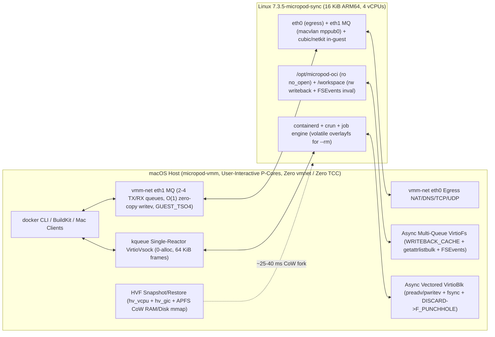

# Micropod B4 and B5 plan for Docker compatibility, CI performance and HVF snapshots

**Date**: 2026-11-25  
**Baseline**: [Phase B3 Gamma Results](../benchmarks/2026-11-25/phase-b3-results.md)  
**Target Host**: Gamma (Apple M5 Max, 18 cores, 128 GB RAM, macOS 26.5.1, SDK 26.5)

---

## Native engine production work

Source commit `041776a41d59` consolidates the qualified native engine in `integration/native-engine-convergence-20261126`. The separate branch checkpoints and reproducibility checks are recorded in the [integration handoff](../benchmarks/2026-11-26/workspace-reply-wait-and-native-network.md#branch-consolidation).

The managed runner `4d0fb3989ee4` passed stock Docker and Testcontainers with primary and secondary named IPv4 bridges. All three public attachment paths, disconnect, eight concurrent clients, published HTTP, bidirectional DNS, Ryuk cleanup and same-disk restart passed. An address ownership record now survives failed pod teardown. The pinned API 1.47 comparator matched 16 of 27 groups. The fixed suite exercised 39 operations, and the cumulative probes exercised 49 of 107. [Docker and recovery qualification](../benchmarks/2026-11-26/workspace-reply-wait-and-native-network.md) · [Exact API audit](../benchmarks/2026-11-26/native-docker-api-v1.47-secondary-networks.json.gz)

The final app pairs the B8 guest `da6da0bae1db` with VMM `c129d373975c`, which enables its long metadata cache only after both host watchers start. The managed app and standalone distribution carry their runtime assets. Four current-load pairs per workload on Gamma measured Micropod / OrbStack at 439 / 1,196 ms for eight named services, 296 / 330 ms for eight stock Git jobs, 703 / 745 ms for the warm checkout and 2,028 / 2,225 ms after an edit. All 18 disposable APFS volumes were audited and removed with Spotlight off and zero persistent FSEvents journal bytes. [Full scorecard](../benchmarks/2026-11-26/workspace-reply-wait-and-native-network-gamma.json) · [Earlier five-round B8 comparison](../benchmarks/2026-11-26/phase-b8-virtiofs-notify-and-keep-cache.md)

The next Docker gates are built-in default network attachment, primary detach, static addressing, network events and client-version negotiation. The remaining release gates are a sustained mixed-CI soak and an end-to-end hosted Developer ID build, notarization and clean installation. The release workflow accepts a checksum-pinned runtime artifact from a successful build of the release commit. B7 already exercises a PostgreSQL/HTTP Compose integration and persistent BuildKit caches. [B7 managed CI](../benchmarks/2026-11-26/phase-b7-real-ci-and-caching.json) · [B5 direct restore](../benchmarks/2026-11-25/phase-b5-results.md)

## Earlier November 26 Docker qualification

Zero-`vmnet` egress and the cubic/fq IPvlan comparison have measured B4 results. The active production work qualifies repository-digest image operations and Compose health dependencies through the native managed socket. The latest transport and kernel experiments reduced interrupt traffic and individual FUSE request latency. The complete 1,058-file checkout still favors OrbStack. Retain one workspace queue with the existing completion behavior for CI. [B4 results](../benchmarks/2026-11-25/phase-b4-results.md) · [Native Docker and CI qualification](../benchmarks/2026-11-26/workspace-completion-transport-and-image-load.md)

Runner `55f2ae080a60` passed the native Compose health dependency, an eight-container health transition check, digest-qualified image save and removal, and 543 Linux test cases. The fixed Docker 1.47 comparison matches 16 of 27 groups. Including direct traces, 46 of 107 operations have been exercised. Remaining release work includes public image visibility after forced removal from a stopped container, live network attachment, Testcontainers, wider API coverage, a sustained mixed-CI soak and a clean Developer ID installation. [Exact API inventory](../benchmarks/2026-11-26/native-docker-api-v1.47-image-digests-and-health.json.gz)

## 1. Strategic Objective

Phase B3 measured `micropod-vmm` with the `7.3.5-micropod-sync` kernel. On IPvlan the direct HVF process reached Docker readiness in 0.283 s, compared with 0.767 s for VZ. OrbStack was already running. IPvlan churn took 1.018 s on HVF and 1.813 s on OrbStack. On bridge, published TCP delivered 8,699 and 7,500 MiB/s respectively, with fresh p95 of 3.041 and 5.731 ms. These runs used preloaded images. [B3 scorecards and cold-start boundaries](../benchmarks/2026-11-25/phase-b3-results.md)

The first production milestone now qualifies the managed containerd worker through its Docker socket and the registered Micropod `ci` runtime. Its acceptance checks include backend identity, a writable disk with one active writer, correct guest time, published-port discovery, and a real Compose service. Keep the B3 scorecards as performance references. The stock-client qualification and the remaining release gates are recorded in the [managed engine report](../benchmarks/2026-11-25/managed-engine-compatibility.md).

For CI qualification, run the stock client against the managed socket. A named image loaded from an archive must have the same visible rows and usable repository digest as the stock engine. Move its final tag and restart an existing stopped container to verify the original filesystem. Run Compose with `depends_on: service_healthy` and observe the dependent job, probe failures, recovery and the health event stream. The extended fixture exercises an image-defined probe, a timeout and eight simultaneously running health-checked containers. [Compose qualification](../../scripts/qualify_compose_health.py)

The following B4 and B5 targets cover networking, CI and worker startup. Production promotion also requires the stock-client and installation checks below.

1. **Close the final 3 microbenchmark gaps**: push published TCP past VZ Tuned (`8.70 → 14–18+ GiB/s`, `< 1.0 ms` fresh p95), push in-guest sibling bulk past OrbStack (`18.3 → 25+ GiB/s`), and close the remaining `~10 µs` gap on unrestricted quiet HTTP (`22.7 → ~12–14 µs`).
2. **Win real-world CI workspace & BuildKit workloads**: upgrade RW `VirtioFs` with async queues + `FUSE_WRITEBACK_CACHE` + `getattrlistbulk` + macOS `FSEvents` cache invalidation, move `VirtioVsock` to a single zero-alloc `kqueue` reactor, and add ephemeral `overlayfs` `volatile` mode for `--rm` CI steps.
3. **Ship zero-`vmnet` egress and a complete runtime bundle.** Qualify outbound `eth0` NAT, DNS, TCP, UDP and ICMP inside `vmm-net`, exercise CI workloads on Gamma and package the signed VMM with a matching initrd, kernel and guest tools.
4. **Unlock HVF-exclusive `< 40 ms` VM Snapshot / APFS CoW Fork** for parallel local CI jobs.

---

The following Gamma qualification covers stock Docker and Compose event streams, exec history, mixed-version workspace admission, host-share sync and a 32-compiler crossover. It measures completed compiles during each transfer and reports the 6 GiB and 60 GiB transfers separately. [Managed Docker events and CI density](../benchmarks/2026-11-25/phase-b4-ci-density-and-events.md)

## 2. Target Architecture (Phase B4/B5)

---

## 3. Milestone Execution Plan

### Phase B4.1 — Zero-`vmnet` Outbound Egress (`eth0` NAT / DNS / TCP / UDP / ICMP)
The source-built managed HVF worker pulled an uncached image from Docker Hub, resolved the Alpine mirror, installed a package and downloaded a file over certificate-validated HTTPS. The tested VMM links Hypervisor.framework, libiconv and libSystem. Direct VMM qualification also recorded ICMP echo, loopback and link-local isolation, and 200 successful DNS requests with the host file descriptor count returning to baseline. General UDP flow expiry and behavior across real host network changes remain release checks. [Managed qualification](../benchmarks/2026-11-25/managed-engine-compatibility.json) · [B4 egress](../benchmarks/2026-11-25/phase-b4-results.md) · [B6 isolation and DNS](../benchmarks/2026-11-25/phase-b6-production-hardening.md)

**Why first**: Makes `micropod-vmm` 100% online and self-contained (`docker pull`, `apk`/`apt`, `cargo fetch`, `go get`, `npm ci`) without ever touching `vmnet.framework` or triggering macOS Local Network TCC prompts.

- **Targets**:
  - [vmm/crates/vmm-net/src/lib.rs](../../vmm/crates/vmm-net/src/lib.rs) (extract shared frame/TCP primitives and add `egress.rs` module)
  - [vmm/crates/vmm-core/src/lib.rs](../../vmm/crates/vmm-core/src/lib.rs) (wire `eth0` `VirtioNetEgress` alongside `eth1` `VirtioNetBridge`)
  - [vmm/guest-init/main.go](../../vmm/guest-init/main.go) (configure host DNS forwarding on `10.42.0.1:53` + default route)
- **Design**:
  - Guest→Host outbound TCP (`SYN` on `eth0` → non-blocking Darwin `connect()` in `kqueue`, zero-copy `GuestMemory -> writev()`, reusing our `O(1)` TCP engine + `HOST_TSO4`).
  - Guest→Host outbound UDP + DNS proxy (`10.42.0.1:53` forwarded to host system resolvers via `/etc/resolv.conf` / Darwin `res_init` / UDP sockets with NAT table + idle GC).
  - Direct ICMP echo reply/proxy (`ping`) and ARP responder for `10.42.0.1`.
  - Respect host `HTTP_PROXY` / IPv4 private-range isolation policy (never allow guest containers to reach unauthorized host loopback ports unless explicitly published via `ports.sock`).
- **Acceptance Criteria**:
  - `docker pull alpine:3.23`, `apk add`, `curl https://...`, and `dig` succeed end-to-end inside `micropod-vmm` with zero `vmnet` and zero TCC prompts.
  - Unit tests covering outbound TCP handshake/teardown, UDP NAT expiration, DNS forwarding, and host-loopback isolation.

---

### Phase B4.2 — Multi-Queue `vmm-net` (`VIRTIO_NET_F_MQ`) + `GUEST_TSO4` + `SYNC_COLOCATE` Softirq Guard
The reconciled VMM implements feature negotiation for multiple queues and guest TSO4 and can publish used-ring entries in a batch. The later managed VMM reached 11,768 MiB/s with 3.62 ms fresh p95 on one port in two pairs. The throughput and latency acceptance targets below remain open. [Managed Gamma qualification](../benchmarks/2026-11-25/phase-b4-managed-performance.md)

**Target**: **`14–18+ GiB/s` published TCP bulk** (beating both OrbStack `7.5 GiB/s` AND VZ Tuned `11.3 GiB/s`) + **`< 1.0 ms` fresh p95** with 0 failures / 0 reopens.

- **Targets**:
  - [vmm/crates/vmm-net/src/lib.rs](../../vmm/crates/vmm-net/src/lib.rs)
  - [vmm/crates/vmm-virtio/src/lib.rs](../../vmm/crates/vmm-virtio/src/lib.rs)
  - [bench/phase0-host-scheduling/ci/patches/sync-colocate.patch](../../ci/patches/sync-colocate.patch)
  - [bench/phase0-host-scheduling/ci/runner/published-ports.sh](../../ci/runner/published-ports.sh)
- **Design**:
  1. **Multi-queue Virtio-Net (`VIRTIO_NET_F_MQ`, `VIRTIO_NET_F_CTRL_VQ`)**: expose `max_virtqueue_pairs = 4` (queues `0..7` data + queue `8` control for `VIRTIO_NET_CTRL_MQ_VQ_PAIRS_SET`). Spawn 1 P-core `vmm-net-tx-q` drainer per TX queue so all 4 Linux vCPUs execute `writev()` in parallel with zero lock contention across flows!
  2. **Dedicated fresh-connection RX queue**: steer newly accepted flows (`bytes_relayed < 64 KiB`, `SYN`/`SYN-ACK`/fresh HTTP GETs) onto RX queue `0`, and established bulk flows onto RX queues `1..3` (zero head-of-line blocking behind bulk ACKs).
  3. **`VIRTIO_NET_F_GUEST_TSO4` + `VIRTIO_NET_F_MRG_RXBUF`**: emit 64 KiB coalesced host→guest segments for uploads (`docker load`, BuildKit context transfer, HTTP POST uploads).
  4. **`SYNC_COLOCATE` hardware-IRQ guard**: in `select_task_rq_fair()`, skip `SYNC_COLOCATE` when woken from hardware-IRQ NAPI (`virtnet_poll` on `eth1`), recovering the `+840 MiB/s` published-TCP throughput measured in Phase B3 A/B while keeping `19 µs` `dns1` and `22 µs` `quiet_http`.
- **Acceptance Criteria**:
  - Single-port `offered-mac` (32 bulk + 40 fresh req/s): **`>= 13,000 MiB/s`** median bulk, **`<= 1.2 ms`** fresh p95, `0` failures, `0` reopens.
  - Host→Guest upload throughput (`128 MiB` POST / `docker load`): **`>= 5,000 MiB/s`**.

---

### Phase B4.3 — In-Guest Bulk Throughput (`25+ GiB/s`) & Quiet HTTP Latency (`~12–14 µs`)
The managed four-vCPU HVF worker supports a per-network CUBIC route. The launcher also requests CUBIC for the HVF guest when the kernel provides it. It won six quiet 6 GiB pairs against OrbStack. With 32 compilers running, Micropod lost three of four 6 GiB pairs on the initial image and won all four 60 GiB pairs. In the B5 bridge sweep, 150 µs of idle polling reduced unrestricted quiet HTTP p50 from 40.92 to 26.67 µs. The 12–15 µs target remains open. [Managed network results](../benchmarks/2026-11-25/phase-b4-managed-performance.md) · [32-compiler results](../benchmarks/2026-11-25/phase-b4-ci-density-and-events.md) · [B5 idle-poll sweep](../benchmarks/2026-11-25/phase-b5-results.md)

**Target**: Beat OrbStack on **6 GiB sibling bulk (`> 24.0 GiB/s`)** and narrow/close the **unrestricted quiet HTTP (`22.7 → ~12–15 µs`)** gap without regressing `dns32` or `churn`.

- **Targets**:
  - [bench/phase0-host-scheduling/ci/patches/build-sync-colocate-kernel.sh](../../ci/patches/build-sync-colocate-kernel.sh)
  - [bench/phase0-host-scheduling/ci/runner/start.sh](../../ci/runner/start.sh)
  - [bench/phase0-host-scheduling/guest/runner/docker_networks_linux.go](../../guest/runner/docker_networks_linux.go)
- **Experiments (controlled paired A/B on Gamma)**:
  1. **TCP Congestion Control & Qdisc A/B**: enable `CONFIG_TCP_CONG_CUBIC=y` + `CONFIG_DEFAULT_CUBIC=y` (keeping `bbr` available via sysctl) and test `cubic + fq_codel` vs `bbr + fq` on 6 GiB in-guest sibling bulk (`bridge` and `ipvlan`). Removing BBR software pacing on in-RAM links targets **`+30–40%` bulk (`18.3 → 24–26+ GiB/s`)**.
  2. **`netkit` L3 Container Interfaces**: benchmark Linux 7.3.5 `netkit` (already compiled in via `CONFIG_NETKIT=y`) against `bridge` and `ipvlan` for both sibling bulk and quiet HTTP latency.
  3. **Unrestricted Quiet HTTP Scheduler Study**: A/B `NO_TTWU_QUEUE`, `sched_min_granularity` / `base_slice_ns`, and `wake_wide()` threshold on Go's 3-goroutine `http.Transport` to understand if unrestricted quiet HTTP can hit `~12–15 µs` with zero regression on `dns32` p95 (`< 320 µs`) and `32×8` churn (`< 1.05 s`).

---

### Phase B4.4 — High-Performance RW `VirtioFs`, `kqueue` `VirtioVsock` & Ephemeral `volatile` OverlayFS
The mutable share preserves the inode held by an open descriptor during atomic replacement. The first asynchronous worker passed all 24 host-edit checks and read 512 files in 48–51 ms. In the later comparison the default asynchronous reader took 13.01 and 13.76 ms on two fresh workers. OrbStack took 6.45 ms and failed all four held-descriptor checks during atomic replacement. Longer cache lifetimes still require verified invalidation under concurrent opens. B4 also implemented the kqueue vsock reactor and APFS discard. [Initial measurements](../benchmarks/2026-11-25/phase-b4-managed-performance.md) · [B4 device changes](../benchmarks/2026-11-25/phase-b4-results.md) · [Matched reader and edit checks](../benchmarks/2026-11-25/phase-b5-managed-checkout-and-archive.md)

**Target**: Beat OrbStack on **real host-mounted CI compiles (`cargo`/`go`/`npm`/`git status`)** and push **`32×8` ephemeral churn `< 0.75 s` (`42+ c/s`)**.

- **Targets**:
  - [vmm/crates/vmm-virtio/src/virtiofs.rs](../../vmm/crates/vmm-virtio/src/virtiofs.rs)
  - [vmm/crates/vmm-virtio/src/vsock.rs](../../vmm/crates/vmm-virtio/src/vsock.rs)
  - [vmm/crates/vmm-virtio/src/lib.rs](../../vmm/crates/vmm-virtio/src/lib.rs) (`VirtioBlk` `VIRTIO_BLK_F_DISCARD` → `fcntl(F_PUNCHHOLE)`)
  - [bench/phase0-host-scheduling/guest/runner/docker_engine_linux.go](../../guest/runner/docker_engine_linux.go) (ephemeral `overlayfs` `volatile` option)
- **Design**:
  1. **Async Multi-Queue RW `VirtioFs`**:
     - Move request queue off the vCPU MMIO trap thread onto a 4-thread worker pool (matching `num_request_queues = 4` + P-core QoS).
     - Enable `FUSE_WRITEBACK_CACHE` + `FUSE_ATOMIC_O_TRUNC` + `FUSE_DO_READDIRPLUS` backed by Darwin `getattrlistbulk()` (1 syscall per directory instead of `N × lstat()`!).
     - The disposable CI drive uses `.fseventsd/no_log` and volume-scoped Spotlight exclusion before workers start. Verify both at read-only retirement. Qualify writable shares by checking exact bytes through open handles, host edits, atomic replace and remount. Any future FSEvents-based invalidation experiment needs separate evidence for dropped events and correctness before increasing cache lifetimes.
     - The proposed watcher observes the shared host checkout. Keep on-disk FSEvents logging and Spotlight indexing disabled on the benchmark worker's APFS disk. Verify host-to-guest edits and missed-event recovery on the actual shared filesystem before extending its cache lifetimes.
  2. **Single-Reactor Zero-Alloc `kqueue` `VirtioVsock`**:
     - Replace the 3-OS-threads-per-connection architecture in `vsock.rs` with 1 P-core `kqueue` event loop managing all Unix streams + zero-alloc direct scatter/gather into VirtQueue RX/TX descriptors + `64 KiB` packet coalescing.
     - Eliminates ~500 `pthread_create` calls per `32×8` churn wave and boosts BuildKit / `docker load` / `docker logs` streaming throughput.
  3. **`VirtioBlk` Auto-Shrink (`DISCARD` → `F_PUNCHHOLE`)**:
     - Advertise `VIRTIO_BLK_F_DISCARD` and translate guest `fstrim` / discard ranges to macOS `F_PUNCHHOLE`, keeping sparse APFS worker disks compact over long CI sessions.
  4. **Ephemeral `--rm` `overlayfs` `volatile` mount**:
     - For `AutoRemove` containers, pass `volatile` (or optional tmpfs upperdir) so containerd/crun skips ext4 sync work on throwaway CI steps.
- **Acceptance Criteria**:
  - `32×8` ephemeral `--rm` churn: **`<= 0.75 s`** (`>= 42 c/s`, **2.4× faster than OrbStack**).
  - Host-mounted workspace `git status` + `tar` extract + `go build` / `cargo check` inside container: **faster than or within 5% of OrbStack**, with host edits visible inside guest in **`< 50 ms`**.

---

### Phase B4.5 — Real-Workload CI Benchmark Suite & Production Packaging
The managed worker completed a cold and warm two-stage Buildx build and ran 32 distinct programs in simultaneously resident containers. Paired checkout tests now cover real Git, build and test work on one job and on eight overlapping jobs. The warm 1,058-file checkout still favored OrbStack. Longer CI soak testing and a clean signed installation remain open. [Buildx and CI qualification](../benchmarks/2026-11-25/managed-engine-compatibility.md) · [Paired checkout measurements](../benchmarks/2026-11-25/phase-b5-managed-checkout-and-archive.md)

- **New Paired Gamma Benchmarks** (extend [bench_engine_tuning.py](../../scripts/bench_engine_tuning.py)):
  1. **Workspace Bind-Mount Suite**: cold/warm `stat` storm (`find /workspace`), `tar` extract, `go test` / `cargo check` on host-mounted source tree, and host-edit visibility latency.
  2. **BuildKit Multi-Stage Build**: cold + incremental layer-cache `docker build` latency.
  3. **32-Port High-Fanout Published TCP**: 32 distinct published ports under concurrent bulk + fresh arrivals (`offered-mac --targets`).
  4. **Memory Elasticity**: peak vs post-idle RSS after a 2 GiB allocation spike (measuring `VirtioBalloon` `MADV_FREE` reclaim speed).
- **Runtime Packaging & Soak Hardening**:
  - Bundle signed `micropod-vmm`, `mp-hvf-init.cpio`, and `7.3.5-micropod-sync` alongside `micropod` in Swift release builds (`Package.swift` / build scripts).
  - Clean `PSCI SYSTEM_OFF` / `SIGTERM` graceful worker drain, crash diagnostics, and 60-second `vmm-net` + `virtiofs` concurrency soak tests.

---

### Phase B5 — Sub-40 ms HVF VM Snapshot & APFS CoW Fork (CI Rig Superpower)
On the final source build a direct restore reached Docker ping in 17.23 ms median and first container in 180.34 ms median. Eight concurrent forks all ran their first container in 552.24 ms. All 15 VMM processes exited cleanly. Managed per-job provisioning and clean signed installation remain release gates. [Final fork and shutdown qualification](../benchmarks/2026-11-25/phase-b5-managed-checkout-and-archive.md)

**Why**: Neither Apple `Virtualization.framework` nor OrbStack supports sub-50 ms isolated microVM cloning. For local CI rigs running isolated per-job VMs, snapshotting a warmed worker once (`0.28 s`) and forking per job in `~25–40 ms` removes cold-boot overhead entirely.

- **Design**:
  1. **Checkpoint (`--snapshot-save <dir>`)**: quiesce vCPUs via `hv_vcpus_exit`, serialize vCPU sysregs + FP/SIMD (`hv_vcpu_get_reg` / `hv_vcpu_get_sys_reg`), GICv3 state (`hv_gic_state_create` / `hv_gic_get_state`), VirtQueue ring indices, and flush guest RAM backing file + APFS CoW disk clone (`clonefile()`).
  2. **Restore (`--snapshot-load <dir>`)**: `clonefile()` disk + `mmap(MAP_PRIVATE)` guest RAM file (lazy APFS CoW demand paging—only touched 16 KiB pages fault!), restore GICv3 + vCPU state, inject fresh `mp.instance` / entropy / clock jump (`CNTVOFF_EL2` offset + `virtio-rng`), and resume `hv_vcpu_run()`.
- **Acceptance Criteria**:
  - Warm fork from snapshot to `docker run --rm alpine:3.23 true` completion: **`<= 100 ms`** end-to-end (`<= 40 ms` VMM resume-to-ready).
  - Isolated per-fork filesystem, network sockets, and clean OOM attribution (`OOMKilled=true`, exit 137).

---

## 4. Recommended Execution Sequence & Risk Gates

| Order | Milestone | Primary Impact | Key Verification Gate |
|---|---|---|---|
| **Production entry** | **Managed worker and stock-client compatibility** | Docker and Compose discover the native worker, preserve writable roots across restart, launch the image entrypoint as PID 1 and receive container and exec events. | The source build passed restart, recovery, event replay and a 60 GiB transfer with 32 active compilers. Open gates include extended Docker API coverage, warm large-checkout performance, long-running workloads and a signed installation on a clean Mac. [First qualification](../benchmarks/2026-11-25/managed-engine-compatibility.md) · [Restart and recovery](../benchmarks/2026-11-25/phase-b4-managed-performance.md) · [Events and CI](../benchmarks/2026-11-25/phase-b4-ci-density-and-events.md) |
| **1** | **B4.1** (`eth0` zero-`vmnet` egress) + **B4.3** (`cubic`/`netkit` bulk A/B) | Online drop-in parity + beat OrbStack `24 GiB/s` sibling bulk | `docker pull` + `curl` online w/ 0 TCC; paired IPvlan 6 GiB bulk receipt |
| **2** | **B4.2** (MQ `vmm-net` + `GUEST_TSO4` + NAPI guard) | Beat BOTH VZ (`11.3 GiB/s`) & OrbStack (`7.5 GiB/s`) on published TCP + `< 1 ms` p95 | Paired 1-port & 32-port `offered-mac` receipts (0 errors, 0 reopens) |
| **3** | **B4.4** (Async RW `VirtioFs` + `FSEvents` + `kqueue` `VirtioVsock` + `volatile` overlayfs) | Beat OrbStack on host-mounted CI compiles & `< 0.75 s` churn | New workspace/BuildKit Gamma paired suite + host-edit coherency test |
| **4** | **B4.5** (Packaging, soak tests & default promotion) | Production-ready `MICROPOD_CI_VMM=hvf` shipping path | Full Rust/Go/Swift test suites + 60 s soak + clean host hygiene |
| **5** | **B5** (`< 40 ms` HVF Snapshot / CoW Fork) | Unmatched isolated per-job CI worker boot speed | Snapshot save/restore determinism + multi-fork isolation test |

## Managed checkout, Docker archives and HVF retirement

B4.4 and B4.5 now have interleaved OrbStack comparisons for Git, real Go builds and tests from a mounted checkout, including eight simultaneous jobs. B5 has independent five- and eight-way direct fork qualification with process exit checks. The production engine passes the Docker archive lifecycle matrix on HVF and VZ. The managed engine now streams attached exec output and supports stdin, PTYs, resize, working-directory and environment overrides on HVF and VZ. The subsequent public-machine qualification passed interactive PID 1 attach. Long-running CI, live network changes and a clean signed installation remain open. [Gamma report](../benchmarks/2026-11-25/phase-b5-managed-checkout-and-archive.md)

## Managed engine qualification on 26 November

Stock-client exec, job-local checkout transfer, eight concurrent mounted builds and the remaining schema-1 worker snapshot limitations have a separate Gamma scorecard. The large warm host-mounted checkout still favors OrbStack. Keep VZ detached-start reliability under a slow event subscriber, independent restored worker identities, and clean signed installation open for promotion. [Managed CI and Docker compatibility](../benchmarks/2026-11-25/managed-ci-git-and-exec.md)

The main checkout’s supervised HVF machine has a separate public entry point. On Gamma its socket passed the five stock Docker exec groups and a binary archive round trip. The Micropod CLI now preserves noninteractive text output and guest exit status and can dispatch detached commands on this endpoint. The native CLI’s interactive exec, copy and export paths and stock Docker’s interactive PID 1 attach still require implementation and qualification. [Machine and CLI acceptance results](../benchmarks/2026-11-25/managed-ci-git-and-exec.md#main-checkout-machine-and-micropod-cli)

The subsequent core CLI qualification covers live binary stdout and stderr, piped stdin, EOF and API version negotiation on the public machine. Native terminal exec and stock Docker attachment to the container's initial process remain separate release gates. For mounted CI, use the mutable checkout scorecard and the immutable publisher contract when evaluating B4.4 and B4.5. The kernel experiment uses one image for both settings of its lookup-completion switch. [Core and mounted-CI scorecard](../benchmarks/2026-11-26/mounted-ci-gamma.md) · [Pinned-checkout evidence](../benchmarks/2026-11-26/pinned-checkout.md) · [Kernel experiment](../benchmarks/2026-11-26/virtiofs-sync-lookup-kernel.md)

## Production Docker compatibility order

Use the Docker socket published by `micropod machine docker-endpoint` for stock-client acceptance. Run the same commands against the managed CI worker where its lifecycle differs. Record the backend, client version, API version and exit status with each case. The core CLI and the desktop shim have their own entry points and qualification results. [Core CLI scorecard](../benchmarks/2026-11-26/mounted-ci-gamma.md) · [Managed worker coverage](../benchmarks/2026-11-25/managed-engine-compatibility.md)

| Priority | Capability | Acceptance |
|---|---|---|
| 1 | Interactive container and exec sessions | Stock `docker run -it` and `docker attach` connect to PID 1, resize its terminal, detach and reattach, and preserve signal and exit behavior. Native `micropod exec -it` passes its own terminal test. Stock `docker exec -it` and non-TTY binary exec already have Gamma receipts. |
| 2 | Docker workflows used by CI | Exercise live network connect/disconnect, image-ID removal and pruning, and image, network and volume events with stock clients. Re-run the existing Compose, Buildx, archive and restart cases against the same packaged worker. Verify that concurrent jobs cannot see each other's writable data. |
| 3 | Distribution and sustained operation | From a clean installation, start the signed bundled engine without development path overrides, run concurrent checkout/build/test jobs through the public socket, restart the worker, and account for containers, mounts, disks and processes afterward. Re-run the mutable checkout edit checks before promoting any host filesystem optimization. |

B5 snapshot promotion also requires independently identified guest workers and writable storage isolation through the managed path. The direct resume clock and the time to the first completed job remain separate measurements. [Fork identity and managed CI evidence](../benchmarks/2026-11-25/managed-ci-git-and-exec.md#hvf-snapshot-and-production-boundaries)

## Interactive Docker and mutable CI qualification

Stock Docker now exercises the initial process on the public HVF machine with interactive run, resize, simultaneous attachment, detach and reattach, and restart. The native CLI passed terminal exec checks on HVF and OrbStack, including eight simultaneous terminals. Both clients also completed the eight-container binary transfer faster on HVF in all four paired rounds. The 1,058-file raw mounted checkout still favors OrbStack. Retain the same client, CPU and memory budget, host byte-visibility checks and alternating order when qualifying workspace changes. [Public engine results](../benchmarks/2026-11-26/core-pid1-and-mutable-gamma.md)

The B4.4 filesystem gate now includes held read-only and read-write descriptors, atomic replacement, file-to-pipe transfers and already-faulted shared guest mappings after a same-inode host rewrite with exact mtime restoration. Qualify those operations with Spotlight and per-volume FSEvents journaling disabled on the disposable APFS drive. The B4.5 release gate also includes slow readers, sustained multi-container builds, live networking and a clean installation of the complete signed distribution. Independent restored worker identities remain a B5 requirement.

## Production acceptance after the November 26 density runs

B3 remains the direct, preloaded networking reference. B4.1 already has managed outbound and registry qualification. For B4.4, the writable-workspace option and the matched Linux splice change fixed ordinary held reads, `sendfile` and `splice` under an exact-mtime host rewrite. A resident guest shared mapping still returns old contents, so leave the option gated. The 1,058-file warm checkout continues to favor OrbStack. The filesystem qualification runs with Spotlight indexing and per-volume FSEvents journaling disabled. [Coherency matrix, code and timings](../benchmarks/2026-11-26/core-pid1-and-mutable-gamma.md#matched-linux-splice-backport)

B4.5 now has stock PID 1 attachment, native terminal exec, binary logs exceeding 8 MiB, a two-service stock Compose project and eight- and sixteen-container Git/build/test runs. On a four-vCPU, 4 GiB worker, sixteen cold builds at 256 MiB per job exhausted memory. Preparing eight caches at a time and allowing 384 MiB per job let all sixteen overlap during every scored wave. Production CI acceptance must cover cold admission as well as warm throughput. [CI density and verbose Docker jobs](../benchmarks/2026-11-26/core-pid1-and-mutable-gamma.md#ci-density-on-the-disk-backed-logging-guest)

The final signing path verifies the VMM entitlement, and the signed headless archive takes its staged engine files from the sealed app. The ad-hoc replay covers the staging logic. Promotion still requires a complete Developer ID build installed on a clean Mac, a sustained mixed CI workload, live network attachment and a production allocation with a stock Docker client. B5 still requires independently identified restored workers. [Distribution and native API qualification](../benchmarks/2026-11-26/core-pid1-and-mutable-gamma.md#distribution-signing)

The native API 1.47 inventory exercises 38 of 107 operations and matches 13 of 24 differential case groups. Earlier guests matched ten and eleven of 23 respectively. The native guest supports ordered image history, validated repository-digest lookup and local tag creation and replacement. Stock Docker on build `5de5611a7371` also restarted a stopped container from its original imported image after the image's final named tag moved. The test checks bare hexadecimal repositories, immutable aliases and config IDs. The subsequent native registry qualification covers login, push and remote-only pull. Remaining production checks include live network attachment, Compose readiness and Testcontainers on the installed native socket. The older dockerd 1.56 audit covers a separate backend. [Current native inventory](../benchmarks/2026-11-26/native-docker-api-v1.47-image-recovery.json.gz) · [Failure and stock-client replay](../benchmarks/2026-11-26/native-storage-park-gamma.md#restart-after-the-last-named-tag-moves)

For B4.4 the managed VMM now parks idle VirtioFS and block workers on queue notifications. With eight idle containers, host VMM CPU fell from 11.0 to 7.1 ms/s, and the raw warm checkout remained at 912 ms versus 666 ms on OrbStack. Use the stock mounted workload to track that gap. An opt-in four-process Git clean check keeps all 1,058 content scans and has separate clean and dirty workload measurements. The November 24 baseline and B3 three-way scorecards remain the historical networking references. [Storage and native engine qualification](../benchmarks/2026-11-26/native-storage-park-gamma.md) · [CI clean check](../benchmarks/2026-11-26/mounted-git-status.md)

For a mostly clean CI checkout, the opt-in check took the full single-job warm build from 915 to 850 ms and the eight-container clean Git wave from 350 to 319 ms on Micropod. The eight-way run used 58% more median CPU per job. OrbStack stock Git completed the same wave in 139 ms. Keep stock Git as the production default and track dirty builds, CPU per job and warm throughput separately. [Eight-container CI measurements](../benchmarks/2026-11-26/mounted-git-gate-density.md)

## Registry publication and mounted CI on Gamma

The native Engine API now has a private TLS registry qualification for stock login, push, all tags and a remote-only pull, including eight concurrent publications. The pinned general audit and the registry fixture together exercise 41 of 107 Docker 1.47 operations. On the 1,058-file Mac checkout, asynchronous workspace close reduced a warm Git/build/test job from 903 to 845 ms, with OrbStack at 676 ms in the candidate window. Pinning Git to CPU 0 improved one job and slowed eight concurrent checks, so shared workers retain automatic CPU placement. [Registry and CI scorecard](../benchmarks/2026-11-26/native-registry-and-mounted-ci.md) · [Kernel and teardown qualification](../benchmarks/2026-11-26/virtiofs-workspace-async-release.md)

The subsequent native guest `e00d6da9b0b2` added bounded removal of unused single-manifest image IDs and a content lease for active pushes. Stock Docker removed nine unused IDs and returned a verified registry digest after another client deleted the uploading image locally. The final pinned audit matched 13 of 24 groups. Forced deletion of an image held by a stopped container, platform-selective push and an installed mixed-CI qualification remain open. [Final Docker inventory](../benchmarks/2026-11-26/native-docker-api-v1.47-image-id-final.json.gz) · [Image lifecycle and measured CPU placement](../benchmarks/2026-11-26/native-registry-and-mounted-ci.md)

For the next B4.4 experiment, compare guest VirtioFS completion placement with one and eight unpinned stock Git jobs. Moving the single workspace interrupt moved the fastest Git CPU, while pinning all eight jobs to it added 205 ms per wave on Micropod. Record per-CPU interrupt counts, cgroup CPU, wave makespan and the existing held-file and last-unmount checks before changing shared-worker scheduling. [IRQ routing and density comparison](../benchmarks/2026-11-26/native-registry-and-mounted-ci.md#cpu-placement)

One integrated Gamma worker then ran eight and sixteen simultaneous Git/build/test containers with the native registry runner, event-driven VMM and workspace async release enabled. All eight-job pairs and all sixteen-job warm pairs favored Micropod. Sixteen edited jobs split 2–2. The same worker passed TLS registry publication and removal of the source ID during upload. All CI jobs ran with automatic CPU placement. [Combined CI and Docker qualification](../benchmarks/2026-11-26/native-registry-and-mounted-ci.md#eight-and-sixteen-ci-containers-on-the-combined-engine) · [Combined scorecard](../benchmarks/2026-11-26/native-combined-integration-gamma.json)

## Native stock builds and workspace queue qualification

For B4.4, Gamma tested four workspace request queues and submitter-CPU completion independently. Four queues exposed one ring per guest CPU while sharing one host worker. Neither change improved the paired performance relative to OrbStack on the 1,058-file checkout. Keep one queue, standard completion and automatic CPU placement. Measure reductions in synchronous host file work against the same large checkout, both single-job and eight-way, with the descriptor, mutation, fsync and remount tests. The disposable APFS volume must retain disabled Spotlight indexing and per-volume FSEvents journaling through teardown. [Queue and Buildx scorecard](../benchmarks/2026-11-26/workspace-queues-and-native-buildx.md) · [Guest completion and trace results](../benchmarks/2026-11-26/virtiofs-workspace-local-completion.md)

For B4.5, add stock Buildx's native Docker driver, cold and cached local exports, two-tag and unnamed loads, literal `--iidfile` reuse, and overlapping builds to the native Engine release checks. Include Docker ancestry across retags and an actual classic-builder parent chain in the compatibility inventory. Keep the signed clean install, sustained mixed CI, live network attachment, Compose health and Testcontainers in the production acceptance path. B5 still requires independently identified restored workers with isolated writable data. [Native build evidence](../benchmarks/2026-11-26/workspace-queues-and-native-buildx.md) · [Ancestry qualification](../benchmarks/2026-11-26/native-container-ancestor-gamma.md)

The next production build must also reproduce the label-scoped ImageList checks on stock Docker. Runner `eb363bff62ac` matched all eleven raw API filter cases and selected the same distinct IDs in seven stock CLI queries. Docker renders additional rows on Micropod for named imports that have a second repository digest. Keep the strict 15/27 result and verify any import change against digest-only images, historical aliases and stopped-container restart after the final tag moves. The documented native API surface exercised is 43/107 operations. [Final native compatibility inventory](../benchmarks/2026-11-26/native-docker-api-v1.47-image-list.json.gz) · [Native Buildx and CI report](../benchmarks/2026-11-26/workspace-queues-and-native-buildx.md)
